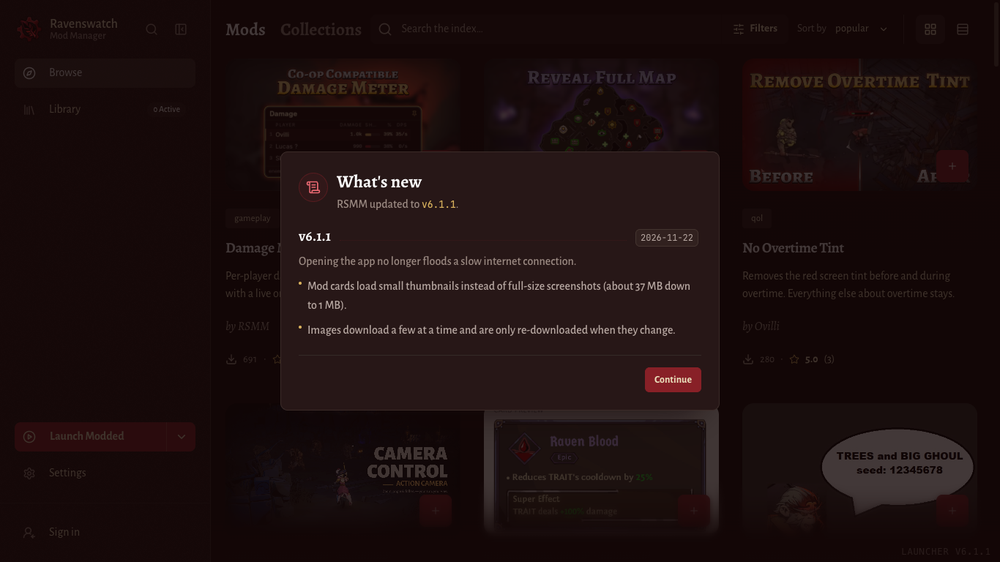
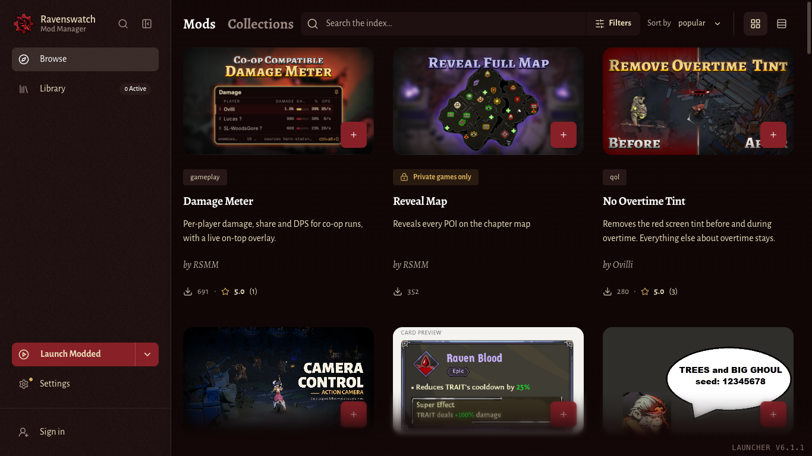
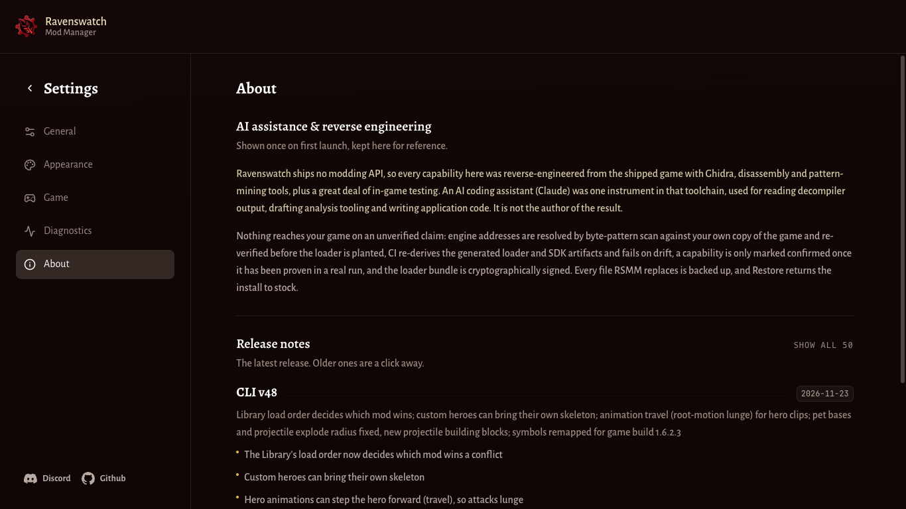
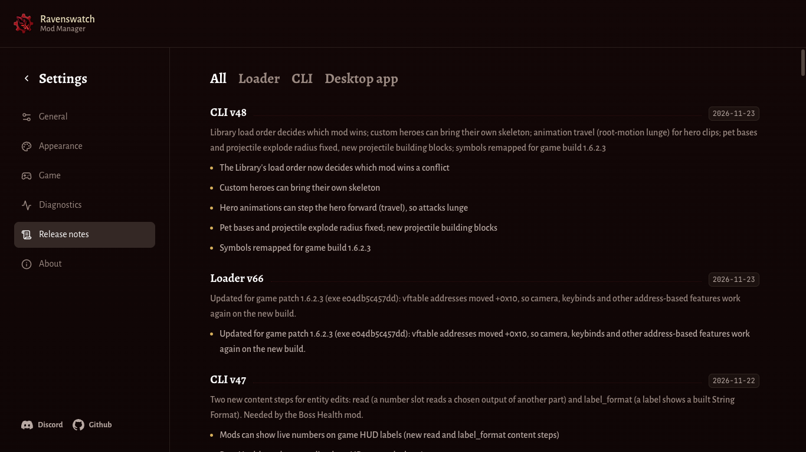
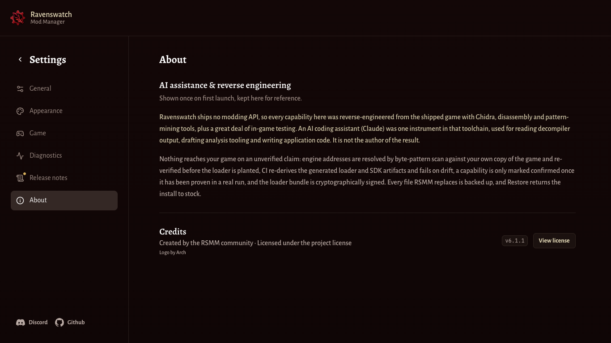

# Optional update notes

Before screenshots were captured from `origin/main` at `a21908b8`, before editing.
The desktop and shared UI are unchanged on the PR base at `c654a360`.
Before and after use the same 1366 × 768 browser viewport, app version 6.1.1,
and saved read version 6.1.0 to simulate a returning user after an app update.
The Browse screenshots use the same live registry state.

| State | Before | After |
| --- | --- | --- |
| Startup after update |  |  |
| Release notes location |  |  |
| Settings → About |  |  |

Additional checks:

- `after-settings-unread.png`: General settings leaves the Release notes dot and read version unchanged.
- `after-collapsed.png`: the Settings dot remains visible in the collapsed sidebar at 960 × 720.
- `after-settings-narrow.png`: the Release notes dot remains visible with icon-only categories at 600 × 720.
- `after-release-notes-narrow.png`: the channel tabs fit at 600 × 720 with no horizontal overflow; keyboard arrows and Home/End select and focus the expected filter.
- `after-release-notes-loader.png`, `after-release-notes-cli.png`, and `after-release-notes-desktop.png`: the filters show only their respective channel (17 Loader, 22 CLI, and 11 desktop releases); All restores all 50.
- Native list markers align with the first line on both single-line and wrapped entries.
- About does not acknowledge release notes. The command palette opens Release notes directly.
- All 50 known releases are always expanded, with no expand/collapse control, and use the page scroll without a nested scroll area; reloading after reading does not restore the indicator.
- Desktop tests (513), TypeScript, Biome on changed files, and the Vite production build pass.

For a UX PR, embed the uploaded Before and After screenshots at the top of its description as required by AGENTS.md.
